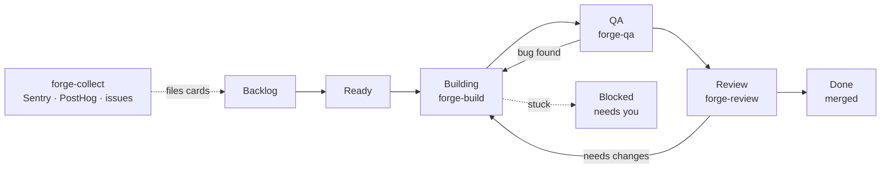

<div align="center">


<h1>nFactory-Forge Agent</h1>

<p><strong>Put tasks on a GitHub board. Get tested, reviewed, merged pull requests back.</strong></p>

<p>8 skills (5 you type, 3 the board runs) · runs inside Claude Code</p>

</div>

## What it is

nFactory-Forge turns a GitHub Project board into an automatic software team. You write a card,
move it to **Ready**, and AI agents inside Claude Code build it, test it, review it and merge it.
Every step leaves its proof (tests, screenshots, review notes) on the GitHub issue and pull request.

## Install

You need: [Claude Code](https://claude.com/claude-code), `git`, [`gh`](https://cli.github.com) (signed in
with `gh auth login`), `jq`, `node` and Python 3.9+. The installer checks and tells you what's missing.

In your project folder:

```bash
curl -fsSL https://raw.githubusercontent.com/antrung699/nfactory-forge-agent/main/get.sh | bash
```

This copies the skills, scripts, workflows and safety guards into your project's `.claude/` folder.
Run the same line again any time to update.

## Start a new project

**1. Install** (above), inside the project folder.

**2. Onboard** — open Claude Code in the folder and run:

```
/nfactory-forge onboard
```

Onboard asks a few questions in 8 steps. Press <kbd>Enter</kbd> to take the recommended answer.

| Step | What happens |
|---|---|
| 1 · Checks | Installs anything missing, including the Dynamics CRM DevKit MCP (see below) |
| 2 · GitHub | Checks you're signed in and connects the repo (offers to create one if there is none) |
| 3 · Board | Creates or connects the Project board and its columns |
| 4 · Branch | Picks the branch pull requests merge into |
| 5 · AGENTS.md | Writes the project rules the agents follow |
| 6 · Policies | Who merges (you or the agents) and how database migrations run |
| 7 · Bug sources | Optional: Sentry, PostHog and other places to find bugs |
| 8 · Review | Shows everything, then writes it all in one go |

You only onboard once per project. Running it again checks and repairs the setup.

**3. Add work** — create issues on the board with a clear goal and acceptance criteria, then move
them to **Ready**. Check your cards with:

```
/nfactory-forge lint
```

**4. Run**:

```
/nfactory-forge run
```

The agents take every Ready card through the lanes below until the board is empty. Use
`/nfactory-forge status` to see progress and `/nfactory-forge stop` to stop safely. Work in
progress is kept and picks up where it left off next run.

## How it works



1. **Plan.** `/nfactory-forge run` reads the board and picks the Ready cards that can start now
   (cards whose blockers are done). It sends them out in waves, several at a time.
2. **Build** (`forge-build`). Each card gets its own git worktree. The agent writes a failing test
   first, makes the smallest change that passes it, and opens a draft pull request.
3. **QA** (`forge-qa`). Another agent runs the change in a real browser, saves screenshots and logs,
   and checks the tests cover the change. A bug sends the card back to Build.
4. **Review** (`forge-review`). A third agent reviews the pull request on its own, without
   trusting the builder's summary. Problems send the card back to Build.
5. **Merge.** The merge gate re-runs your project's checks on the latest base branch and merges
   only the exact commit that was reviewed. The card moves to **Done**.
6. **Blocked.** When an agent needs a decision only you can make, the card goes to **Blocked**
   with a short question on the issue. Answer it and move the card back to Ready.

Cards labelled `qa` skip Building and go straight to QA. Everything else is built first.

The session where you type `/nfactory-forge run` only coordinates. It never writes product code
itself; all the work happens in the lane agents, and all the state lives on the GitHub board.

## Skills

**8 skills (5 you type, 3 the board runs).**

<!-- skills:start -->
**You type — 5 skills**

| Skill | What it does |
|---|---|
| [`/nfactory-forge`](skills/nfactory-forge/README.md) | Orchestrator: plans waves, runs Build → QA → Review, merges when green. |
| [`/forge-collect`](skills/forge-collect/README.md) | Finds problems (Sentry, PostHog, issues, PRs, architecture) and files verified Backlog cards. |
| [`/ui-refine-loop`](skills/ui-refine-loop/README.md) | Critique → refine loop that polishes one page or component. |
| [`/visual`](skills/visual/README.md) | One HTML page: branch recap, plan, or codebase map with diagrams. |
| [`/git-sync`](skills/git-sync/README.md) | Commit per logical change, merge-pull, push without force, report. |

**The board runs — 3 lanes**

| Skill | What it does |
|---|---|
| [`/forge-build`](skills/forge-build/README.md) | Builder lane: worktree, smallest safe change, tests, draft PR. |
| [`/forge-qa`](skills/forge-qa/README.md) | Tester lane: evidence, test-gap check, screenshots, or bounce to Build. |
| [`/forge-review`](skills/forge-review/README.md) | Reviewer lane: own hypotheses, remembers prior findings, merge gate. |
<!-- skills:end -->

## Commands

```
/nfactory-forge onboard        # set up this project (8 steps, resumes)
/nfactory-forge lint           # check cards have clear acceptance criteria
/nfactory-forge run            # work through the board
/nfactory-forge status         # see what's happening
/nfactory-forge stop           # stop safely
/forge-collect [source]        # find bugs and file them as cards
/ui-refine-loop <page>         # polish one page
/visual                        # one HTML page: recap, plan or code map
/git-sync                      # commit, pull, push
```

`run --low` uses cheaper models, `run --high` uses the strongest ones.

## Dynamics CRM DevKit MCP

Onboard also sets up the [Dynamics CRM DevKit](https://github.com/phuocle/Dynamics-Crm-DevKit) MCP
server, so the agents can read your Dataverse environment.

- Step 1 installs the `devkit` .NET tool (needs .NET 10; onboard offers the install command).
- Step 8 adds `dynamicscrm-devkit` to the project's `.mcp.json`, signed in with your active
  `pac` profile (`pac auth create` if you have none).
- It starts in **readonly** mode. Change `readonly` to `all` in `.mcp.json` when you want the agents
  to change Dataverse.

You can also run it by hand: `.claude/bin/nfactory-forge-devkit-mcp.sh install` then `… config`.

## Safety guards

These run automatically once installed:

| Guard | Stops |
|---|---|
| guard-secrets | Reading `.env` files, SSH keys and other secrets |
| guard-key-literals | API keys being written into code |
| guard-delete-outside | Deleting files outside the project |
| guard-worktree-path | Git worktrees outside `.claude/worktrees/` |
| guard-protected-push | Direct or force pushes to `main` (optional, onboard asks) |
| cleanup-wt | Not a blocker: removes worktrees after their work is merged |

## License

MIT, see [LICENSE](LICENSE).
